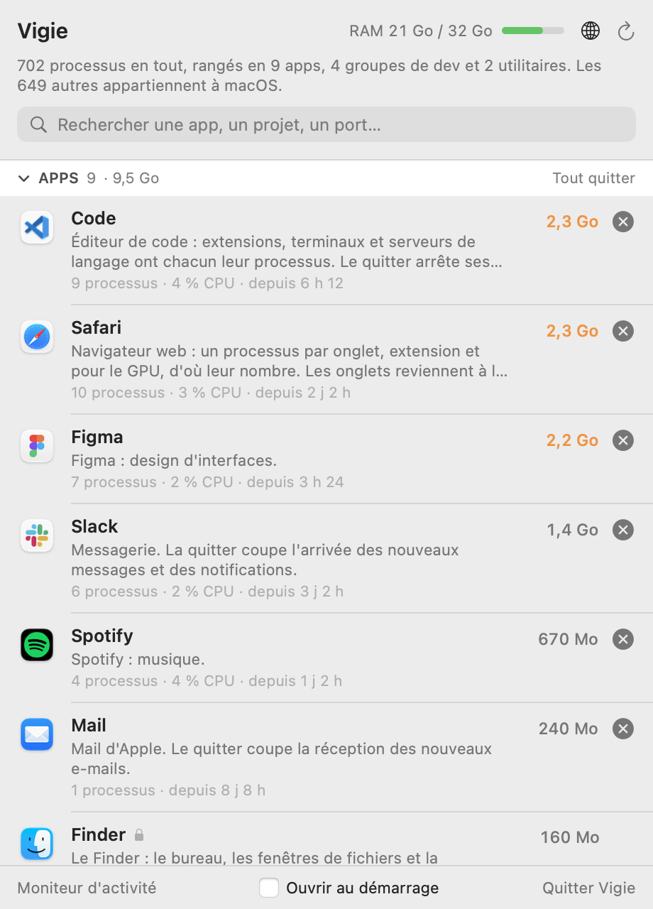
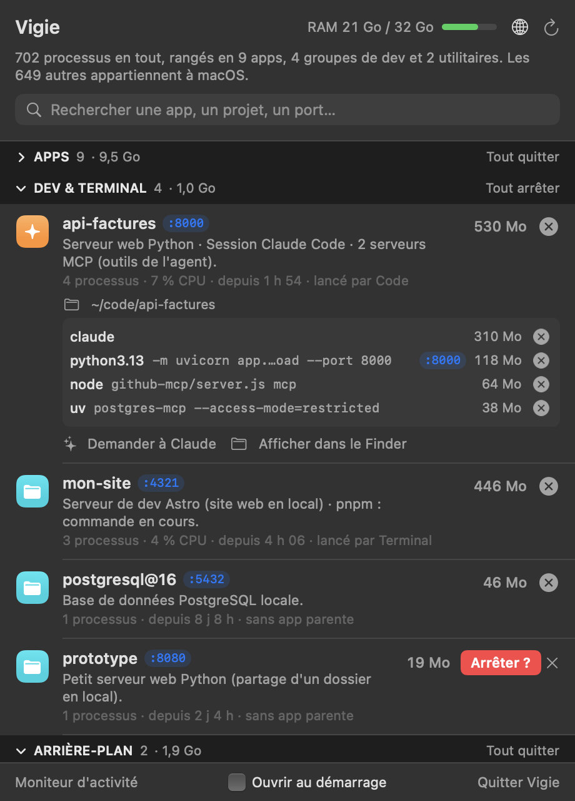
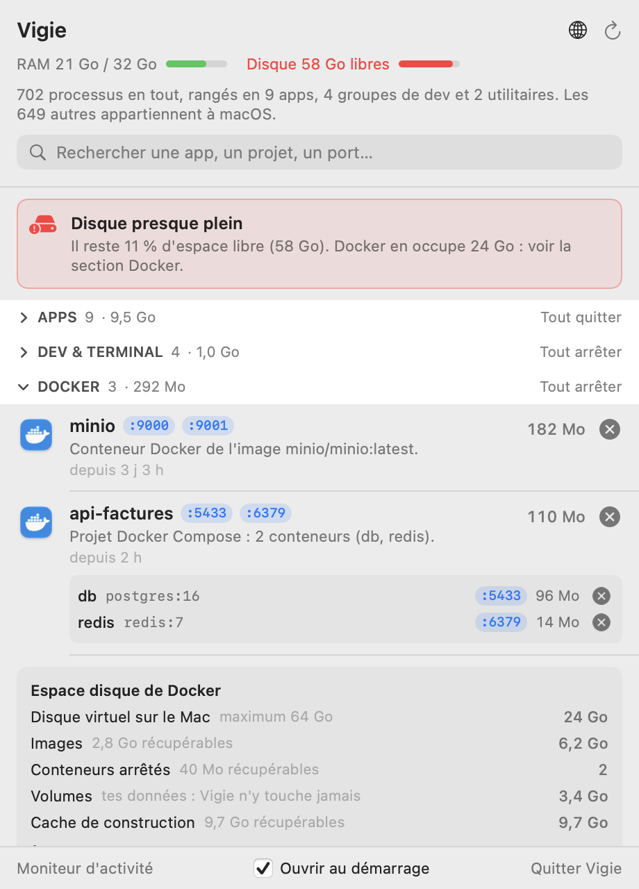

<p align="center">
  
</p>

<h1 align="center">Vigie</h1>

<p align="center">
  Le Moniteur d'activité, en lisible.<br>
  Une app de barre des menus macOS qui regroupe le millier de processus de ton Mac en quelques dizaines de lignes, explique chacune en français simple et permet de les fermer sans risque.
</p>

<p align="center"><a href="README.md">English</a> · <b>Français</b></p>

<p align="center">
  
  &nbsp;
  
</p>

<p align="center"><sub>Captures prises avec le mode démo : un Mac fictif, aucune donnée réelle.</sub></p>

## Pourquoi

Le Moniteur d'activité affiche plus de mille lignes : « Opera Helper (Renderer) » vingt fois, des `node` sans nom, des services aux noms obscurs. Impossible de savoir ce qui consomme vraiment, d'où ça vient, ni ce qu'on peut fermer sans casser quelque chose.

## Ce que fait Vigie

- **Regroupe** les processus en quatre rubriques :
  - **Apps** : chaque app avec tous ses processus d'aide (onglets d'un navigateur, extensions, services que macOS lui attribue).
  - **Dev & terminal** : serveurs, agents et outils rangés **par projet** (leur dossier de travail), avec les **ports** ouverts, l'app depuis laquelle ils ont été lancés et depuis quand. Un serveur dont le terminal a été fermé est signalé « sans app parente ».
  - **Arrière-plan** : utilitaires sans fenêtre (barre des menus, synchronisation, agents).
  - **Système** : macOS lui-même, repliée par défaut.
- **Explique** chaque ligne en une phrase : navigateurs, éditeurs, serveurs de dev Vite, Astro, Next.js…, serveurs MCP, sessions Claude Code, services macOS courants. Pour le reste, un bouton « Demander à Claude » (optionnel, voir plus bas).
- **Ferme** proprement, en deux clics (× puis « Quitter ? ») :
  - une app reçoit une fermeture normale, comme ⌘Q : elle peut te demander d'enregistrer ;
  - un serveur de dev reçoit une demande d'arrêt (SIGTERM) ;
  - « Forcer » n'apparaît que si rien ne s'est passé au bout de 5 secondes.
- **Ne touche jamais** à macOS, aux processus d'autres utilisateurs, au Finder, au Dock ni au Centre de contrôle.
- Recherche par nom, dossier ou port ; clic sur un port pour ouvrir `http://localhost:…` ; ouverture au démarrage en option.
- **Surveille Docker et ton disque.** Les conteneurs en cours (regroupés par projet Compose, avec leurs ports et leur mémoire) s'arrêtent comme le reste. Vigie montre la place prise par Docker, y compris son disque virtuel sur le Mac même Docker arrêté, et les commandes de nettoyage utiles. Elle ne supprime jamais rien elle-même et ne touche jamais aux volumes. Sous 15 % d'espace libre, la barre des menus affiche le pourcentage libre à côté de l'œil, le panneau affiche une alerte et tu reçois une notification.
- **Parle français et anglais.** Vigie suit la langue de ton Mac ; tu peux en changer à tout moment depuis le menu ⚙︎.
- **Te prévient des nouvelles versions.** « Rechercher une mise à jour » dans le menu ⚙︎, et une vérification automatique une fois par jour, désactivable.

Vigie ne consomme rien quand le panneau est fermé : elle ne relit les processus (toutes les 3 secondes) que lorsqu'il est ouvert.

<p align="center">
  
</p>

## Installation

Prérequis : macOS 14 ou plus récent.

### Télécharger

1. Télécharge `Vigie-x.y.z.zip` depuis la [dernière version publiée](https://github.com/0xG00dKat/vigie/releases/latest), décompresse-le et range `Vigie.app` dans Applications.
2. Vigie n'est pas encore notarisée par Apple : macOS la bloque à la première ouverture. Ouvre **Réglages Système › Confidentialité et sécurité**, descends et clique sur **Ouvrir quand même** à côté du message sur Vigie. (Ou, dans un terminal : `xattr -dr com.apple.quarantine /Applications/Vigie.app`.)

### Compiler depuis les sources

Il faut Swift 6 (fourni avec Xcode ou les outils en ligne de commande : `xcode-select --install`).

```bash
git clone https://github.com/0xG00dKat/vigie.git
cd vigie
./scripts/build-app.sh
cp -R build/Vigie.app /Applications/
open /Applications/Vigie.app
```

L'icône de Vigie (un œil) apparaît dans la barre des menus. Pour l'ouvrir à chaque démarrage, coche « Ouvrir au démarrage » en bas du panneau.

### Mises à jour

Vigie regarde une fois par jour sur GitHub s'il existe une version plus récente et affiche alors un bandeau dans le panneau, avec un bouton **Télécharger**. Tu peux aussi cliquer sur **Rechercher une mise à jour** dans le menu ⚙︎, et y désactiver la vérification quotidienne. Pour mettre à jour, remplace `Vigie.app` dans Applications par la nouvelle ; tes réglages sont conservés. Si tu l'as compilée toi-même : `git pull`, puis `./scripts/build-app.sh`.

## Confidentialité

- Vigie lit les processus localement, avec les API du système. Elle n'a ni compte ni statistiques.
- Sa seule connexion réseau est la recherche de mise à jour : une fois par jour, une requête anonyme à l'API de GitHub qui demande le numéro de la dernière version. Rien sur ton Mac n'est envoyé. Elle se désactive dans le menu ⚙︎.
- Les arguments qui ressemblent à des secrets (`--api-key …`, `TOKEN=…`, `sk-…`) sont masqués à l'affichage.
- **« Demander à Claude »** est optionnel. Il utilise la commande [`claude`](https://docs.claude.com/en/docs/claude-code) (Claude Code) si elle est installée sur ton Mac, avec ton propre compte. Seuls le nom, l'identifiant et le chemin du programme sont envoyés, jamais ses arguments. Les réponses sont gardées dans `~/Library/Application Support/Vigie/` pour ne pas reposer la même question.

## Développement

```bash
swift build                          # compilation
swift test                           # tests
./scripts/build-app.sh               # build/Vigie.app
swift scripts/make-icon.swift        # régénère le logo (Support/)
```

Le binaire a aussi des modes de vérification, sans interface :

```bash
V=build/Vigie.app/Contents/MacOS/Vigie
$V --dump                                   # les groupes en texte
$V --render capture.png --demo --lang fr --dark   # le panneau en image, sur un Mac fictif
$V --debug-close "Nom du groupe"            # ferme un groupe comme le bouton
```

Publier une version : mettre à jour la version dans `Support/Info.plist`, ajouter une section dans `CHANGELOG.md`, commiter sur `main`, puis lancer `./scripts/release.sh X.Y.Z` (vérifications, tests, construction, .zip) et `./scripts/release.sh X.Y.Z --publish` (étiquette et version sur GitHub).

Les captures du README se régénèrent avec :

```bash
$V --render docs/apercu.png --lang fr --demo
$V --render docs/apercu-dev.png --lang fr --demo --dark --collapse apps --expand api-factures --confirm prototype
$V --render docs/screenshot.png --lang en --demo
$V --render docs/screenshot-dev.png --lang en --demo --dark --collapse apps --expand invoices-api --confirm prototype
$V --render docs/apercu-docker.png --lang fr --demo --demo-disk-low --collapse apps --collapse dev --expand api-factures
$V --render docs/screenshot-docker.png --lang en --demo --demo-disk-low --collapse apps --collapse dev --expand invoices-api
```

Chaque texte affiché est écrit en paire français/anglais (`L("…", "…")` ou `tr("…", "…")`) : une traduction manquante ne compile pas.

L'architecture et les règles de regroupement sont décrites dans [AGENTS.md](AGENTS.md).

## Limites

- Docker est lu avec la commande `docker`. C'est testé avec Docker Desktop ; OrbStack et Colima devraient fonctionner mais n'ont pas été testés.
- La mémoire et le CPU des processus lancés par l'administrateur (root) ne sont pas lisibles sans droits supplémentaires : le Moniteur d'activité passe pour cela par un service privilégié.
- Pour rattacher un service système à l'app qui l'utilise, Vigie appelle une fonction non documentée de macOS (`responsibility_get_pid_responsible_for_pid`), comme d'autres outils de surveillance. Elle est chargée dynamiquement : si une version de macOS la retire, ces services restent simplement dans « Système ».
- Les noms d'apps suivent la langue de ton système, tels que macOS les fournit.

## Licence

[MIT](LICENSE) © 2026 G00dKat
