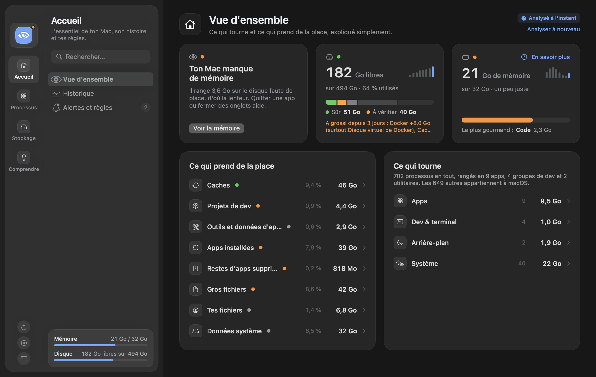
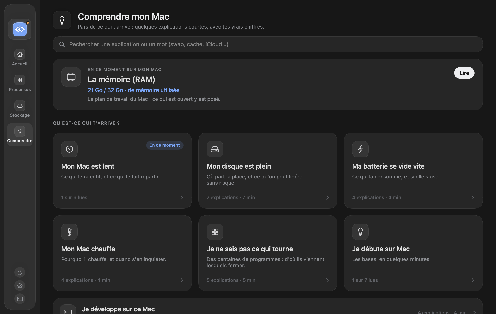

<p align="center">
  
</p>

<h1 align="center">Vigie</h1>

<p align="center">
  <b>Ton Mac, enfin lisible.</b><br>
  Une app macOS qui montre ce qui tourne, ce qui prend la place et ce qui ralentit ton Mac, l'explique simplement et t'aide à faire le ménage sans risque. Elle vit dans la barre des menus et s'ouvre en grand quand tu veux tout voir.
</p>

<p align="center"><a href="README.md">English</a> · <b>Français</b></p>

<p align="center">
  
</p>

<p align="center">
  
  &nbsp;
  
</p>

<p align="center"><sub>Captures prises avec le mode démo : un Mac fictif, aucune donnée réelle.</sub></p>

## Pourquoi

Le Moniteur d'activité affiche plus de mille lignes : « Opera Helper (Renderer) » vingt fois, des `node` sans nom, des services aux noms obscurs. Impossible de savoir ce qui consomme vraiment, d'où ça vient, ni ce qu'on peut fermer sans casser quelque chose.

## Ce que fait Vigie

- **Regroupe** les processus en quatre rubriques :
  - **Apps** : chaque app avec tous ses processus d'aide (onglets d'un navigateur, extensions, services que macOS lui attribue).
  - **Dev & terminal** : serveurs, agents et outils rangés **par projet** (leur dossier de travail), avec les **ports** ouverts, l'app depuis laquelle ils ont été lancés et depuis quand. Un serveur dont le terminal a été fermé est signalé « sans app parente ».
  - **Arrière-plan** : utilitaires sans fenêtre (barre des menus, synchronisation, agents).
  - **Système** : macOS lui-même.
- **Explique** chaque ligne en une phrase : navigateurs, éditeurs, serveurs de dev Vite, Astro, Next.js…, serveurs MCP, sessions Claude Code, services macOS courants. Pour le reste, un bouton « Demander à Claude » (optionnel, voir plus bas).
- **Ferme** proprement, en deux clics (× puis « Quitter ? ») :
  - une app reçoit une fermeture normale, comme ⌘Q : elle peut te demander d'enregistrer ;
  - un serveur de dev reçoit une demande d'arrêt (SIGTERM) ;
  - « Forcer » n'apparaît que si rien ne s'est passé au bout de 5 secondes.
- **Toujours joignable.** Si l'encoche cache l'œil de la barre des menus, rouvre Vigie depuis le Launchpad ou Spotlight : sa fenêtre s'ouvre, avec une icône dans le Dock tant qu'elle reste ouverte (ou toujours, réglage du menu ⚙︎).
- **Ne touche jamais** à macOS, aux processus d'autres utilisateurs, au Finder, au Dock ni au Centre de contrôle.
- Recherche par nom, dossier ou port ; clic sur un port pour ouvrir `http://localhost:…` ; ouverture au démarrage en option.
- **Règles et explications.** Des règles simples (« préviens-moi si Slack dépasse 4 Go », « quitte Slack à 19 h », sans jamais forcer) et une section « Comprendre mon Mac », organisée par question (« Mon Mac est lent », « Mon disque est plein »…) : la mémoire, le swap, les « Données système », pourquoi le disque se remplit, en mots simples, avec des liens « En savoir plus » depuis chaque écran.
- **Se souvient.** Une page « Historique » garde quelques mesures par jour, sur ton Mac seulement, et le raconte : « ton disque a pris 30 Go ce mois-ci », « au rythme actuel, il sera plein dans 6 semaines », « Slack prend environ 2 Go l'après-midi ».
- **Ports et projets.** Une page « Ports » dit qui occupe chaque port (« le port 3000 est déjà pris »), avec le bouton pour l'arrêter, et signale en orange un serveur de dev visible sur le Wi-Fi. Les projets pas touchés depuis six mois sont repérés : leurs dépendances et compilations partent à la corbeille, ton code et l'historique Git restent.
- **Surveille Docker et ton disque.** Les conteneurs en cours (regroupés par projet Compose, avec leurs ports et leur mémoire) s'arrêtent comme le reste. Vigie montre la place prise par Docker, y compris son disque virtuel sur le Mac même Docker arrêté, et les commandes de nettoyage utiles. Elle ne supprime jamais rien elle-même et ne touche jamais aux volumes. Sous 15 % d'espace libre, la barre des menus affiche le pourcentage libre à côté de l'œil, le panneau affiche une alerte et tu reçois une notification.
- **Parle français et anglais.** Vigie suit la langue de ton Mac ; tu peux en changer à tout moment depuis le menu ⚙︎.
- **Reste court.** Les sections sont repliées au départ ; Vigie retient celles que tu ouvres.
- **Montre ce qui prend vraiment de la place.** Une vue « Stockage » (bascule en haut du panneau) mesure, à la demande, ce que macOS range dans « Données système » : caches des outils et des apps (npm, pnpm, uv, navigateurs…), `node_modules` de tes projets (avec depuis quand tu n'y as pas touché), applications, chacune regroupée avec les dossiers qu'elle éparpille dans ta bibliothèque (données, caches, journaux, cookies, réglages…) et sa dernière ouverture, plus gros fichiers (filtrés par type ou « pas ouverts depuis 6 mois ») et doublons (comparés par leur contenu, la copie à garder est conseillée), données des apps. Chaque ligne dit si ça se recrée tout seul ou s'il faut le garder, avec la commande de nettoyage officielle à copier et un bouton « Afficher dans le Finder ». Les caches et les dépendances de projets se nettoient depuis le panneau, après confirmation : la commande officielle de l'outil quand il y en a une (npm, pnpm, uv, Homebrew, Docker…), sinon le cache est supprimé (il se recrée tout seul) et les `node_modules` vont à la corbeille. Vigie ne touche jamais d'elle-même à tes fichiers ni aux données des apps. Une app se désinstalle avec ses restes (tout va à la corbeille, et les dossiers partagés avec une autre app restent), les restes d'apps déjà supprimées sont listés, un bouton « Nettoyer ce qui est sûr » vide les caches après un récapitulatif, et la vue montre ce que macOS range dans « Données système » (systèmes des simulateurs, modèles de Siri et d'Apple Intelligence…).
- **Un panneau et une fenêtre.** Le panneau de la barre des menus garde l'essentiel (mémoire, disque, ce qu'il y a à faire, les apps qui prennent le plus, tes serveurs) avec des actions rapides ; la fenêtre a toutes les pages, rangées en trois familles (Accueil, Processus, Stockage) plus « Comprendre mon Mac ». L'œil en haut de la fenêtre fait le bilan complet et dit comment libérer de la mémoire et de la place.
- **Comprendre mon Mac, par question.** On part de ce qui t'arrive (« Mon Mac est lent », « Mon disque est plein », « Ma batterie se vide vite », « Je débute sur Mac »…) : quelques explications d'une minute à lire dans l'ordre, chacune avec les vrais chiffres de ton Mac et un bouton pour agir. Ce que tu as lu est coché.
- **Te prévient des nouvelles versions.** « Rechercher une mise à jour » dans le menu ⚙︎, et une vérification automatique une fois par jour, désactivable.

Vigie ne consomme rien quand le panneau est fermé : elle ne relit les processus (toutes les 3 secondes) que lorsqu'il est ouvert.

<p align="center">
  
</p>

<p align="center">
  
</p>

## Installation

Prérequis : macOS 14 ou plus récent.

### Télécharger

1. Télécharge `Vigie-x.y.z.dmg` depuis la [dernière version publiée](https://github.com/0xG00dKat/vigie/releases/latest), ouvre-le et glisse Vigie dans le dossier Applications. (Un `.zip` est aussi proposé : décompresse-le et range `Vigie.app` dans Applications.)
2. Ouvre-la : Vigie est signée et notarisée par Apple, elle s'ouvre sans alerte. Son œil apparaît dans la barre des menus.

### Compiler depuis les sources

Il faut Swift 6 (fourni avec Xcode ou les outils en ligne de commande : `xcode-select --install`).

```bash
git clone https://github.com/0xG00dKat/vigie.git
cd vigie
./scripts/build-app.sh
cp -R build/Vigie.app /Applications/
open /Applications/Vigie.app
```

L'icône de Vigie (un œil) apparaît dans la barre des menus. Pour l'ouvrir à chaque démarrage, coche « Ouvrir au démarrage » en bas du panneau.

### Mises à jour

Vigie regarde une fois par jour sur GitHub s'il existe une version plus récente et affiche alors un bandeau dans le panneau, avec un bouton **Télécharger**. Tu peux aussi cliquer sur **Rechercher une mise à jour** dans le menu ⚙︎, et y désactiver la vérification quotidienne. Pour mettre à jour, remplace `Vigie.app` dans Applications par la nouvelle ; tes réglages sont conservés. Si tu l'as compilée toi-même : `git pull`, puis `./scripts/build-app.sh`.

## Confidentialité

- Vigie lit les processus localement, avec les API du système. Elle n'a ni compte ni statistiques.
- Sa seule connexion réseau est la recherche de mise à jour : une fois par jour, une requête anonyme à l'API de GitHub qui demande le numéro de la dernière version. Rien sur ton Mac n'est envoyé. Elle se désactive dans le menu ⚙︎.
- Les arguments qui ressemblent à des secrets (`--api-key …`, `TOKEN=…`, `sk-…`) sont masqués à l'affichage.
- **« Demander à Claude »** est optionnel. Il utilise la commande [`claude`](https://docs.claude.com/en/docs/claude-code) (Claude Code) si elle est installée sur ton Mac, avec ton propre compte. Seuls le nom, l'identifiant et le chemin du programme sont envoyés, jamais ses arguments. Les réponses sont gardées dans `~/Library/Application Support/Vigie/` pour ne pas reposer la même question.

## Développement

```bash
swift build                          # compilation
swift test                           # tests
./scripts/build-app.sh               # build/Vigie.app
./scripts/install.sh                 # remplace /Applications/Vigie.app et relance
swift scripts/make-icon.swift        # régénère le logo (Support/)
```

Le binaire a aussi des modes de vérification, sans interface :

```bash
V=build/Vigie.app/Contents/MacOS/Vigie
$V --dump                                   # les groupes en texte
$V --render capture.png --demo --lang fr --dark   # le panneau en image, sur un Mac fictif
$V --debug-close "Nom du groupe"            # ferme un groupe comme le bouton
```

Publier une version : mettre à jour la version dans `Support/Info.plist`, ajouter une section dans `CHANGELOG.md`, commiter sur `main`, puis lancer `./scripts/release.sh X.Y.Z` (vérifications, tests, construction, .zip) et `./scripts/release.sh X.Y.Z --publish` (étiquette et version sur GitHub).

Les captures du README se régénèrent avec :

```bash
$V --render docs/apercu.png --lang fr --demo
$V --render docs/apercu-dev.png --lang fr --demo --dark --collapse apps --expand api-factures --confirm prototype
$V --render docs/screenshot.png --lang en --demo
$V --render docs/screenshot-dev.png --lang en --demo --dark --collapse apps --expand invoices-api --confirm prototype
$V --render docs/apercu-docker.png --lang fr --demo --demo-disk-low --collapse apps --collapse dev --expand api-factures
$V --render docs/screenshot-docker.png --lang en --demo --demo-disk-low --collapse apps --collapse dev --expand invoices-api
$V --render docs/fenetre.png --lang fr --demo --window overview
$V --render docs/fenetre-comprendre.png --lang fr --demo --window learn --dark
$V --render docs/window.png --lang en --demo --window overview
$V --render docs/window-learn.png --lang en --demo --window learn --dark
```

Chaque texte affiché est écrit en paire français/anglais (`L("…", "…")` ou `tr("…", "…")`) : une traduction manquante ne compile pas.

L'architecture et les règles de regroupement sont décrites dans [AGENTS.md](AGENTS.md).

## Limites

- Docker est lu avec la commande `docker`. C'est testé avec Docker Desktop ; OrbStack et Colima devraient fonctionner mais n'ont pas été testés.
- Certains dossiers (corbeille, sauvegardes d'iPhone, Mail…) sont protégés par macOS : la vue Stockage a besoin de l'accès complet au disque pour les mesurer, et le dit.
- La mémoire et le CPU des processus lancés par l'administrateur (root) ne sont pas lisibles sans droits supplémentaires : le Moniteur d'activité passe pour cela par un service privilégié.
- Pour rattacher un service système à l'app qui l'utilise, Vigie appelle une fonction non documentée de macOS (`responsibility_get_pid_responsible_for_pid`), comme d'autres outils de surveillance. Elle est chargée dynamiquement : si une version de macOS la retire, ces services restent simplement dans « Système ».
- Les noms d'apps suivent la langue de ton système, tels que macOS les fournit.

## Licence

[MIT](LICENSE) © 2026 G00dKat
