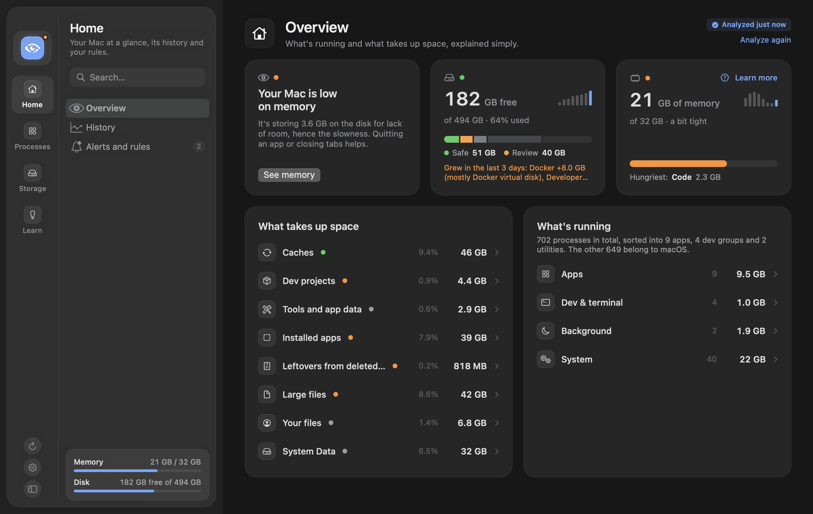
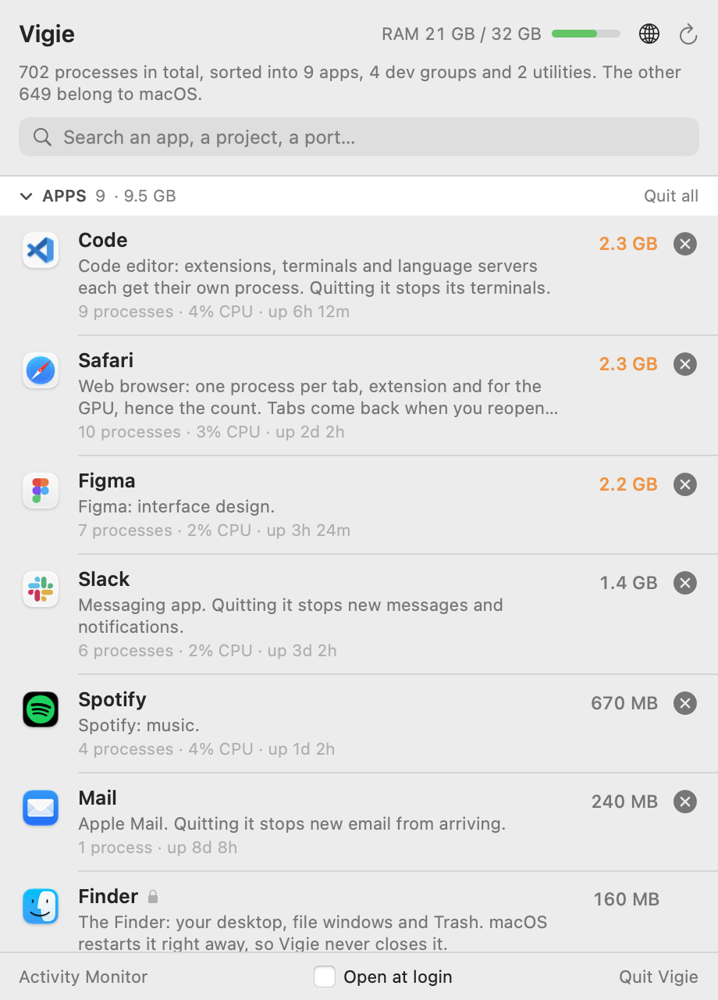
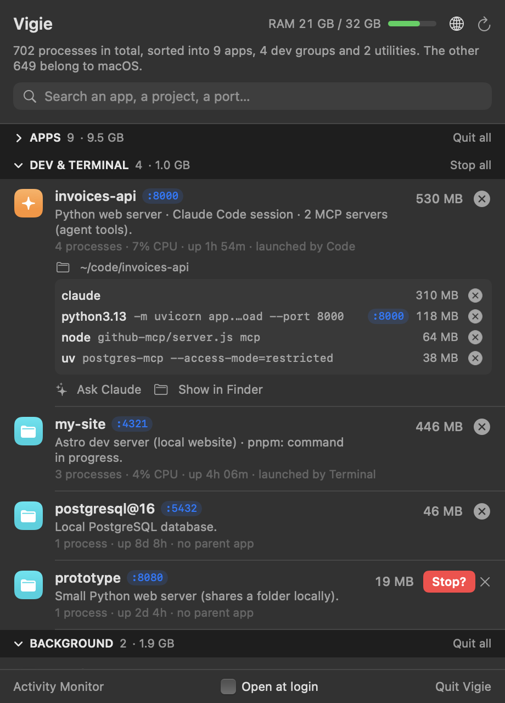
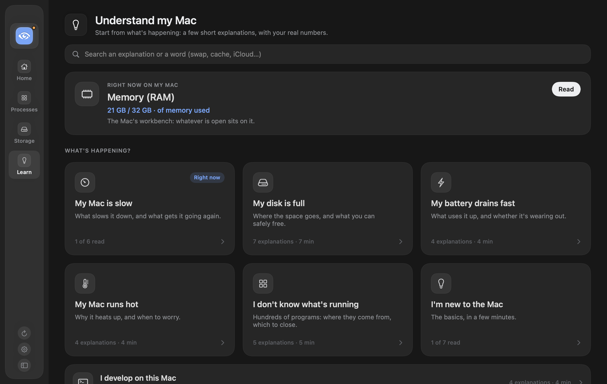
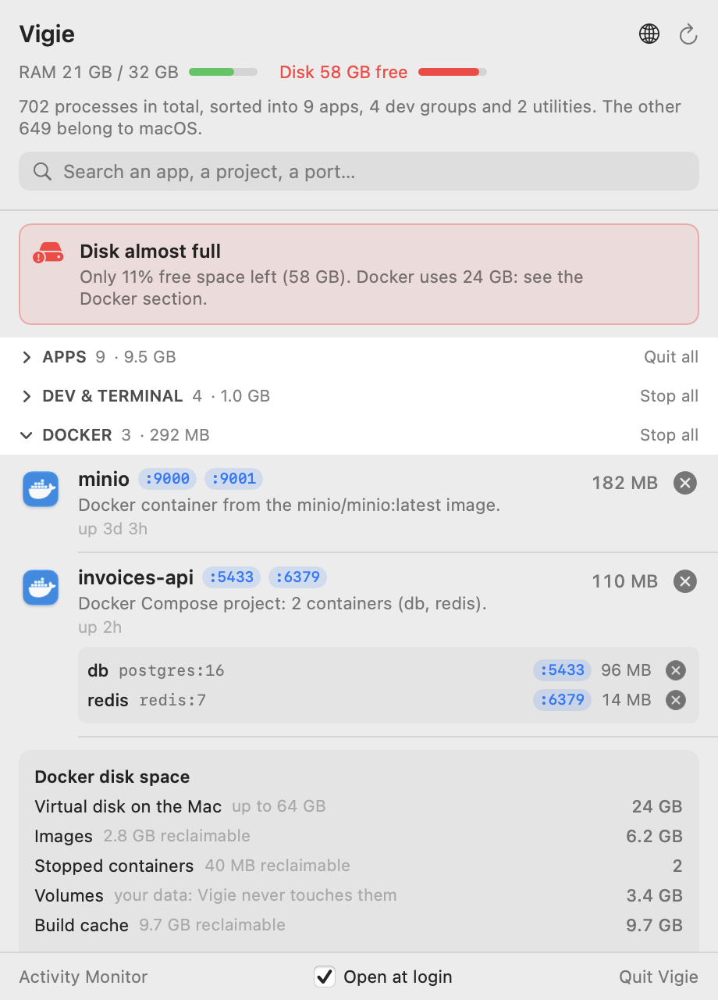

<p align="center">
  
</p>

<h1 align="center">Vigie</h1>

<p align="center">
  <b>Your Mac, finally readable.</b><br>
  A macOS app that shows what's running, what's taking space and what's slowing your Mac down, explains it in plain words and helps you clean up safely. It lives in the menu bar and opens into a full window when you want the whole picture.
</p>

<p align="center"><b>English</b> · <a href="README.fr.md">Français</a></p>

<p align="center">
  
</p>

<p align="center">
  
  &nbsp;
  
</p>

<p align="center"><sub>Screenshots taken in demo mode: a made-up Mac, no real data.</sub></p>

## Why

Activity Monitor shows more than a thousand rows: "Opera Helper (Renderer)" twenty times, unnamed `node` processes, services with cryptic names. There's no way to tell what is really using resources, where it comes from, or what you can close without breaking something.

## What Vigie does

- **Groups** processes into four sections:
  - **Apps**: each app with all its helper processes (browser tabs, extensions, services macOS attributes to it).
  - **Dev & terminal**: servers, agents and tools grouped **by project** (their working folder), with their open **ports**, the app they were started from and how long they've been running. A server whose terminal was closed is flagged "no parent app".
  - **Background**: windowless utilities (menu bar apps, sync, agents).
  - **System**: macOS itself.
- **Explains** each row in one sentence: browsers, editors, Vite, Astro, Next.js… dev servers, MCP servers, Claude Code sessions, common macOS services. For anything else, there's an "Ask Claude" button (optional, see below).
- **Closes** cleanly, in two clicks (× then "Quit?"):
  - an app gets a normal quit, like ⌘Q, so it can ask you to save;
  - a dev server gets a stop request (SIGTERM);
  - "Force quit" only appears if nothing happened after 5 seconds.
- **Always reachable.** If the notch hides the eye in the menu bar, open Vigie again from Launchpad or Spotlight: its window opens, with a Dock icon while it stays open (or always, a setting in the ⚙︎ menu).
- **Never touches** macOS, other users' processes, the Finder, the Dock or Control Center.
- Search by name, folder or port; click a port to open `http://localhost:…`; optional launch at login.
- **Rules and explanations.** Simple rules (“warn me if Slack goes over 4 GB”, “quit Slack at 7 pm”, never forced) and an “Understand my Mac” section, organised by question (“my Mac is slow”, “my disk is full”…): memory, swap, “System Data”, why the disk fills up, in plain words, with “Learn more” links from each screen.
- **Remembers.** A “History” page keeps a few measurements a day, on your Mac only, and tells the story: “your disk grew by 30 GB this month”, “at this pace it will be full in 6 weeks”, “Slack uses about 2 GB in the afternoon”.
- **Ports and projects.** A “Ports” page tells you who holds each port (“port 3000 is already in use”), with a button to stop it, and flags in orange a dev server visible on the Wi-Fi. Projects untouched for six months are spotted: their dependencies and builds go to the Trash, your code and Git history stay.
- **Watches Docker and your disk.** Running containers (grouped by Compose project, with their ports and memory) can be stopped like everything else. Vigie shows how much space Docker takes, including its virtual disk on your Mac even when Docker is stopped, and which cleanup commands are worth running. It never deletes anything itself, and never touches volumes. Below 15% free disk space, the menu bar shows the free percentage next to the eye, the panel shows a warning, and you get a notification.
- **Speaks English and French.** Vigie follows your Mac's language; switch at any time from the ⚙︎ menu.
- **Stays short.** Sections start collapsed; Vigie remembers the ones you open.
- **Shows what really takes up disk space.** A “Storage” view (switch at the top of the panel) measures, on demand, what macOS lumps into “System Data”: tool and app caches (npm, pnpm, uv, browsers…), your projects' `node_modules` (with how long since you touched them), your apps, each grouped with the folders it scatters across your Library (data, caches, logs, cookies, settings…) and when you last opened it, your largest files (filtered by type or “not opened in 6 months”) and duplicates (compared by content, with the copy to keep suggested), and app data. Each line says whether it rebuilds itself or should be kept, with the official cleanup command to copy and a “Show in Finder” button. Caches and project dependencies can be cleaned from the panel after a confirmation: the tool's official command when there is one (npm, pnpm, uv, Homebrew, Docker…), otherwise the cache is deleted (it rebuilds itself) and `node_modules` go to the Trash. Vigie never touches your files or app data on its own. Apps can be uninstalled with their leftovers (everything goes to the Trash, and folders shared with another app stay), leftovers from apps you already deleted are listed, a “Clean what's safe” button clears caches after a summary, and the view shows what macOS keeps in “System Data” (simulator runtimes, Siri and Apple Intelligence models…).
- **A panel and a window.** The menu bar panel keeps what matters (memory, disk, what to do, the heaviest apps, your servers) with quick actions; the window has every page, organised in three families (Home, Processes, Storage) plus “Understand my Mac”. The eye at the top of the window runs a full checkup and says how to free memory and space.
- **Understand my Mac, by question.** Start from what's happening (“my Mac is slow”, “my disk is full”, “my battery drains fast”, “I'm new to the Mac”…): a few one-minute explanations to read in order, each with your Mac's real numbers and a button to act. What you've read is ticked.
- **Tells you about new versions.** “Check for updates” in the ⚙︎ menu, plus an automatic check once a day that you can turn off.

Vigie uses nothing while its panel is closed: it only reads processes (every 3 seconds) while the panel is open.

<p align="center">
  
</p>

<p align="center">
  
</p>

## Installation

Requirements: macOS 14 or later.

### Download

1. Download `Vigie-x.y.z.zip` from the [latest release](https://github.com/0xG00dKat/vigie/releases/latest), unzip it and move `Vigie.app` to Applications.
2. Vigie isn't notarized by Apple yet, so macOS blocks it the first time you open it. Open **System Settings › Privacy & Security**, scroll down and click **Open Anyway** next to the message about Vigie. (Or, in a terminal: `xattr -dr com.apple.quarantine /Applications/Vigie.app`.)

### Build from source

Requires Swift 6 (included with Xcode or the command line tools: `xcode-select --install`).

```bash
git clone https://github.com/0xG00dKat/vigie.git
cd vigie
./scripts/build-app.sh
cp -R build/Vigie.app /Applications/
open /Applications/Vigie.app
```

Vigie's icon (an eye) appears in the menu bar. To start it at every login, tick "Open at login" at the bottom of the panel.

### Updates

Vigie checks GitHub once a day for a newer version and shows a banner in the panel when there is one, with a **Download** button. You can also click **Check for updates** in the ⚙︎ menu, and turn off the daily check there. To update, replace `Vigie.app` in Applications with the new one; your settings are kept. If you built it yourself: `git pull`, then `./scripts/build-app.sh`.

## Privacy

- Vigie reads processes locally, through system APIs. It has no account and no analytics.
- Its only network request is the update check: once a day, an anonymous request to GitHub's API asking for the latest version number. Nothing about your Mac is sent. You can turn it off in the ⚙︎ menu.
- Arguments that look like secrets (`--api-key …`, `TOKEN=…`, `sk-…`) are masked on screen.
- **"Ask Claude"** is optional. It uses the [`claude`](https://docs.claude.com/en/docs/claude-code) command (Claude Code) if it's installed on your Mac, with your own account. Only the program's name, identifier and path are sent, never its arguments. Answers are kept in `~/Library/Application Support/Vigie/` so the same question isn't asked twice.

## Development

```bash
swift build                          # build
swift test                           # tests
./scripts/build-app.sh               # build/Vigie.app
./scripts/install.sh                 # replace /Applications/Vigie.app with it and relaunch
swift scripts/make-icon.swift        # regenerate the menu bar icon from Support/Vigie.icon
```

The binary also has headless check modes:

```bash
V=build/Vigie.app/Contents/MacOS/Vigie
$V --dump                                       # groups as text
$V --render shot.png --demo --lang en --dark    # the panel as an image, on a made-up Mac
$V --debug-close "Group name"                   # closes a group like the button does
```

Publishing a version: update the version in `Support/Info.plist`, add a section to `CHANGELOG.md`, commit on `main`, then run `./scripts/release.sh X.Y.Z` (checks, tests, build, zip) and `./scripts/release.sh X.Y.Z --publish` (tag and GitHub release).

The README screenshots are regenerated with:

```bash
$V --render docs/screenshot.png --lang en --demo
$V --render docs/screenshot-dev.png --lang en --demo --dark --collapse apps --expand invoices-api --confirm prototype
$V --render docs/apercu.png --lang fr --demo
$V --render docs/apercu-dev.png --lang fr --demo --dark --collapse apps --expand api-factures --confirm prototype
$V --render docs/screenshot-docker.png --lang en --demo --demo-disk-low --collapse apps --collapse dev --expand invoices-api
$V --render docs/apercu-docker.png --lang fr --demo --demo-disk-low --collapse apps --collapse dev --expand api-factures
$V --render docs/window.png --lang en --demo --window overview
$V --render docs/window-learn.png --lang en --demo --window learn --dark
$V --render docs/fenetre.png --lang fr --demo --window overview
$V --render docs/fenetre-comprendre.png --lang fr --demo --window learn --dark
```

Every user-facing text is written as a French/English pair (`L("…", "…")` or `tr("…", "…")`), so a missing translation doesn't compile. Architecture and grouping rules are described (in French) in [AGENTS.md](AGENTS.md).

## Limitations

- Docker is read through the `docker` command. It's tested with Docker Desktop; OrbStack and Colima should work but haven't been tested.
- Some folders (Trash, iPhone backups, Mail…) are protected by macOS: the Storage view needs Full Disk Access to measure them, and says so.
- Memory and CPU of processes started by the administrator (root) can't be read without extra privileges: Activity Monitor relies on a privileged service for that.
- To attach a system service to the app using it, Vigie calls an undocumented macOS function (`responsibility_get_pid_responsible_for_pid`), like other monitoring tools. It's loaded dynamically: if a macOS version removes it, those services simply stay under "System".
- App names follow your system language, as macOS provides them.

## License

[MIT](LICENSE) © 2026 G00dKat
